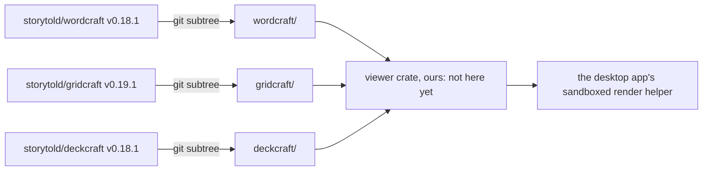

# desktop-office

The office engines behind the Beebeeb desktop app's read-only viewer for Word, Excel and PowerPoint files.
This repository holds three upstream open-source projects, unchanged, as pinned git subtrees. Our own code (a small
viewer crate on top) is not here yet; it comes after the viewer contract is merged
(`docs/superpowers/specs/2026-11-12-native-office-viewer.md` in the desktop repository).

**Nothing here is built, published or uploaded.** There is no CI in this repository: the workflow files inside the
three folders are the upstreams' own and do not run from a subfolder.

## What is in it

| Folder | Upstream | Release tag | Commit | Tree |
|---|---|---|---|---|
| `wordcraft/` | `github.com/storytold/wordcraft` | `v0.18.1` | `079f478bd85df7bcc567e3bafa7d7219096f9c3c` | `5ca7ae4aea4c80b3847de5926f87acedc61ae80c` |
| `gridcraft/` | `github.com/storytold/gridcraft` | `v0.19.1` | `476448d7d9f3a5f8e93fcf7d98b47fd52293fe7f` | `242d37604a83032b95c684a32b547ba9b2a059d2` |
| `deckcraft/` | `github.com/storytold/deckcraft` | `v0.18.1` | `7cc73ab1895ed2e30c8afbcada20c70b9ea0a440` | `5aa3ce6744e927f694dc694acdba2deaac10ca91` |

- Each folder was added with `git subtree add --prefix=<name> https://github.com/storytold/<name> <tag>`, history
  kept. For 3 of 3 folders the tree in this repository equals the tree of the upstream tag
  (`git rev-parse HEAD:<name>` against `git rev-parse <commit>^{tree}`).
- These are the versions the viewer spike measured (desktop PR 351).
- `deny.toml` is our dependency policy (below). `audit/2026-11-12/` holds the raw output of the first audit.

## Licences

- All three projects are licensed **MIT OR Apache-2.0**. Each folder keeps its own `LICENSE-MIT`, `LICENSE-APACHE`,
  `NOTICE` and `ATTRIBUTION.md` (DeckCraft also a `licenses/` folder); they are not moved, merged or edited.
- A build that links any of this code must carry those notices, and the notices of what it links (the bundled
  fonts are under the SIL Open Font License 1.1).
- **The ArtCraft name, wordmark and logos are trademarks and are not under the open licence** (each project's
  `NOTICE` and `docs/brand/`). They sit in the subtrees because the subtrees are unchanged copies; no build of ours
  may contain or show them.

## The subtrees are not self-contained

Each upstream workspace pulls more of the same organisation's code by git revision, outside these folders
(counted by `cargo deny check sources`: 27, 21 and 21 git-sourced packages in the three full workspaces):

- `github.com/storytold/craft-libs` (PDF writing, proofing, font store, font catalogue, audio, media), at 6 different
  revisions in WordCraft, 2 in GridCraft, 3 in DeckCraft;
- `github.com/storytold/egui` and `github.com/storytold/winit` (their forks of the UI toolkit);
- `github.com/storytold/winprint.rs` (printing; WordCraft and GridCraft).

A pin of a subtree therefore also pins those revisions through its `Cargo.lock`. They are part of what a bump
review reads.

## First audit (2026-11-12, on a Linux build machine; cargo-audit 0.23.0, cargo-deny 0.20.2)

Run on each **whole upstream workspace** at the pinned tag, with `deny.toml`. A whole workspace is expected to fail
the network ban: the upstream desktop apps talk to the network. What matters for us is the last table.

| | WordCraft | GridCraft | DeckCraft |
|---|---|---|---|
| Packages in the lockfile | 704 | 656 | 629 |
| `cargo audit`: vulnerabilities | 4 | 5 | 4 |
| `cargo audit`: unmaintained / unsound / yanked | 4 / 2 / 1 | 4 / 2 / 2 | 5 / 2 / 2 |
| `cargo deny check advisories`: errors / warnings | 9 / 1 | 9 / 2 | 9 / 2 |
| `cargo deny check bans` (network, TLS, socket and async-runtime crates present) | 9 | 9 | 4 |
| `cargo deny check licenses`: packages outside the permissive allow-list | 3 | 2 | 18 |
| `cargo deny check sources`: git-sourced packages | 27 | 21 | 21 |

- **The vulnerabilities:** `zip 3.0.0` has 4 advisories in all three (RUSTSEC-2026-0367, -0368, -0369, -0429). All
  four are about extracting an archive **to disk** (symbolic links, permission bits, an abort on a symlink entry).
  The three projects read archives in memory: a search finds 270 uses of `ZipArchive` and 0 calls of an
  extract-to-disk function in their crates. So they are not reachable as the code stands; the advisory still shows
  until upstream moves to a fixed `zip`. GridCraft's fifth is `webpki-root-certs` (RUSTSEC-2026-0383), which comes
  with the network client.
- **Unmaintained or unsound:** `ttf-parser` and `rustybuzz` (font parsing and shaping, unmaintained), `tokio` and
  `rustix` (one unsound advisory each), `proc-macro-error`, and three D-Bus crates (`zvariant`, `zbus_names`,
  `zvariant_derive`).
- **Licences outside the allow-list:** `CDLA-Permissive-2.0` (`webpki-roots`, `webpki-root-certs`: the root
  certificates of the network client), `Ubuntu-font-1.0` (the UI toolkit's default fonts), and in DeckCraft 16
  `symphonia` packages under **MPL-2.0** (audio decoding for slide media).

### Which crate reaches a network client or an async runtime

From `cargo metadata` at the pinned tags, normal dependencies, default features. "Reaches" means the crate's
dependency closure contains one of: `reqwest ureq hyper h2 curl isahc attohttpc tiny_http tungstenite rustls
native-tls openssl quinn socket2 mio tokio async-std smol async-io`.

| Upstream | Workspace crates that reach one | Through | Crates that reach none |
|---|---|---|---|
| WordCraft (19 crates) | **7:** `wordcraft` (app), `wordcraft-cli`, `wordcraft-engine`, `wordcraft-mcp`, `wordcraft-ui-egui`, `wordcraft-web`, `wordcraft-zotero` | `wordcraft-engine` → `craft-font-store` → `ureq`, `rustls`. The app and UI also: `craft-update` → `ureq`, `rustls`; `craft-ui`, `eframe`, `winit`, `rfd` → `tokio`, `mio`, `socket2`; `zbus` → `async-io` | **12:** `wordcraft-control-key`, `-doc`, `-docbin`, `-docx`, `-fonts`, `-formats`, `-geom`, `-layout`, `-metafile`, `-pdf`, `-render`, `xtask` |
| GridCraft (18 crates) | **3:** `gridcraft` (app), `gridcraft-ui-egui`, `gridcraft-web` | `craft-update` → `ureq`, `rustls`; `craft-ui`, `eframe`, `winit`, `rfd` → `tokio`, `mio`, `socket2`; `zbus` → `async-io` | **15:** `gridcraft-calc`, `-chart`, `-cli`, `-core`, `-engine`, `-formula`, `-functions`, `-math`, `-mcp`, `-model`, `-numfmt`, `-pdf`, `-sandbox`, `-xlsx`, `xtask` |
| DeckCraft (24 crates) | **3:** `deckcraft` (app), `deckcraft-ui-egui`, `deckcraft-web` | `craft-update` → `ureq`, `rustls`; `craft-ui`, `eframe`, `winit`, `rfd`, `cpal` → `tokio`; `eframe` → `async-io` | **21:** `deckcraft-anim`, `-av1`, `-bitstream`, `-cli`, `-color`, `-engine`, `-fonts`, `-format`, `-geom`, `-h264`, `-hevc`, `-mcp`, `-media`, `-metafile`, `-model`, `-pdf`, `-pptx`, `-render`, `-text`, `-vp9`, `xtask` |

### What a viewer may link, and what comes with it

| Roots a viewer would link | Packages | Network crates | Git-sourced | With an advisory | Licence outside the allow-list |
|---|---|---|---|---|---|
| `wordcraft-render` + `wordcraft-docx` + `wordcraft-docbin` | 165 | **0** | 1 (`craft-proof`) | 1 (`zip`) | 0 |
| `gridcraft-engine` | 128 | **0** | 0 | 1 (`zip`) | 0 |
| `deckcraft-render` + `deckcraft-pptx` | 123 | **0** | 1 (`epaint_default_fonts`, from the egui fork) | 1 (`zip`) | 0 |
| `deckcraft-engine` (for comparison) | 194 | 0 | 5 | 3 (`zip`, `ttf-parser`, `rustybuzz`) | 16 (`symphonia`, MPL-2.0) |
| `wordcraft-engine` (for comparison) | 282 | **2** (`ureq`, `rustls`) | 6 | 2 (`zip`, `rustix`) | 2 (`webpki` root certificates) |

**May link:** `wordcraft-render`, `-layout`, `-docx`, `-docbin`, `-doc`, `-fonts`, `-geom`, `-metafile`;
`gridcraft-engine` and everything below it; `deckcraft-render`, `-pptx`, `-model`, `-text`, `-fonts`, `-color`,
`-geom`, `-format`, `-metafile`.
**Must not link:** `wordcraft-engine` (it brings a network client through the font store), any `*-ui-egui`, `*-web`,
`*-mcp`, `wordcraft-zotero`, the three apps, and anything that depends on `craft-update` or `craft-font-store`.
**Avoid unless needed:** `deckcraft-engine` and `deckcraft-media` (MPL-2.0 audio decoders, more git sources).

These tables are read from dependency metadata. Nothing was compiled, so they are the plan's starting point, not
proof: the proof is `cargo tree` on our own viewer crate once it exists, with `cargo deny check bans` at 0.

## How an upstream update is reviewed

The upstreams are about five weeks old, release almost daily and have about 100 contributors each. A pin never moves
by itself.

1. One pull request per project, containing only `git subtree pull --prefix=<name> https://github.com/storytold/<name> <new tag>`
   and the new line in the table above (tag, commit, tree).
2. The pull request body lists the upstream commit range and its diff stat. A reviewer reads every changed file
   under the crates the viewer may link (the "May link" list), and every changed revision of a git-sourced
   dependency of those crates. The UI, web and app folders are not reviewed, because they are not linked.
3. On the new pin: `cargo audit`; `cargo deny check` with `deny.toml`; the network map above regenerated. A crate
   moving from "reaches none" to "reaches one", a new git source, a new licence outside the allow-list or a new
   vulnerability in a "May link" closure blocks the bump until someone has decided on it in writing.
4. The viewer's fidelity corpus (once it exists) is run on the new pin: the count of correctly rendered pages may
   not drop.
5. No automatic bumps. At most one bump per project per release of the desktop app, unless a security fix needs one.

## Not done

- Nothing is compiled or tested here. No viewer crate, no CI.
- The audit was run on fresh clones of the three upstream tags, not on this repository's checkout; the trees are
  identical (first table), so the lockfiles are the same files.
- `main` is not branch-protected yet.
- Whether this repository becomes public is the owner's decision. It must be public before a public branch of the
  desktop app depends on it.
