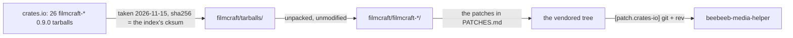

# filmcraft/: FilmCraft 0.9.0, vendored for the desktop app's media helper

The media helper of the Beebeeb desktop app (`native/beebeeb-media-helper` in the desktop repository, a sandboxed
process that decodes one audio or video file and holds no key) builds on FilmCraft's demuxers and decoders. They are
taken from HERE, at a pinned commit of this repository, never from crates.io (decision D-MED-11: FilmCraft is weeks old,
has one publisher and no public source repository; the same rule as the three Office engine subtrees).

## What is here
| Path | What |
|---|---|
| `filmcraft-*/` (26) | The crates as their `.crate` tarballs unpack (normalized `Cargo.toml`, `Cargo.toml.orig`, sources, licences). Cargo finds each by its package name when a build depends on this repository by git. |
| `tarballs/` | The 26 `.crate` files exactly as crates.io served them. |
| `CHECKSUMS.sha256` | Their sha256 hashes. |
| `index-snapshot/` | crates.io's index entries for the 26 crates as cargo cached them on 2026-11-15 (each holds the `cksum` of every version, and the dependency lists). |
| `verify.sh` | Checks the tarballs against `CHECKSUMS.sha256` and those hashes against the index: prints `26 of 26 … 0 mismatched`. |
| `PATCHES.md` | Every file changed after unpacking, why, and the patch itself (`patches/`). |

The 26: `filmcraft-codecs` (the hub) and its whole FilmCraft closure: aac, ac3, apv, av1, avi, bitstream, color, dng, dnx,
frame, h264, hevc, isobmff, matroska, media, mpa, mpeg2v, mpegts, mxf, ogg, opus, prores, time, vp8, vp9.

## Licence
Each crate says `license = "MIT OR Apache-2.0"` in its manifest. None of the 26 names a copyright holder; a release that
links them carries the MIT and Apache-2.0 texts with "Copyright (c) the FilmCraft authors" and the list of modified files
(`PATCHES.md`). FilmCraft brings `symphonia` 0.5.5 from crates.io (MPL-2.0, unmodified; not vendored).

## Corresponding source
The unmodified sources are the crates.io tarballs (`https://crates.io/api/v1/crates/<name>/0.9.0/download`, hashes above)
and this folder; the changes are `PATCHES.md` and `patches/`.

## A bump
Its own pull request: new tarballs, `CHECKSUMS.sha256`, `index-snapshot/`, the unpacked trees, `verify.sh` green, the
patches re-applied, and the diff of every crate the helper links read by a person. Then the helper's `rev` moves.
