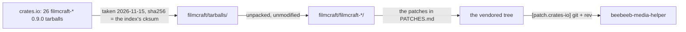

# filmcraft/: FilmCraft 0.9.0, vendored for the desktop app's media helper

The media helper of the Beebeeb desktop app (`native/beebeeb-media-helper` in the desktop repository, a sandboxed
process that decodes one audio or video file and holds no key) builds on FilmCraft's demuxers and decoders. They are
taken from HERE, at a pinned commit of this repository, never from crates.io (decision D-MED-11: FilmCraft is weeks old
and has one publisher; the same rule as the three Office engine subtrees). Since 2026-11-15 FilmCraft has a public source
repository; our fork of it is `github.com/beebeeb-io/filmcraft`. The tarballs here stay the source of record; "Upstream
source" below says which public commit each one is.

## What is here
| Path | What |
|---|---|
| `filmcraft-*/` (26) | The crates as their `.crate` tarballs unpack (normalized `Cargo.toml`, `Cargo.toml.orig`, sources, licences). Cargo finds each by its package name when a build depends on this repository by git. |
| `tarballs/` | The 26 `.crate` files exactly as crates.io served them. |
| `CHECKSUMS.sha256` | Their sha256 hashes. |
| `index-snapshot/` | crates.io's index entries for the 26 crates as cargo cached them on 2026-11-15 (each holds the `cksum` of every version, and the dependency lists). |
| `verify.sh` | Checks the tarballs against `CHECKSUMS.sha256` and those hashes against the index: prints `26 of 26 … 0 mismatched`. |
| `PATCHES.md` | Every file changed after unpacking, why, and the patches themselves (`patches/`), in the order they apply. |
| `patches-check.sh` | Rebuilds the tree from `tarballs/` plus the patches and compares it with every `filmcraft-<x>/`: prints `26 of 26 crates equal …, 0 differ`. |
| `upstream-match.sh` | Compares each crate here with the public FilmCraft repository (see "Upstream source"). |

The 26: `filmcraft-codecs` (the hub) and its whole FilmCraft closure: aac, ac3, apv, av1, avi, bitstream, color, dng, dnx,
frame, h264, hevc, isobmff, matroska, media, mpa, mpeg2v, mpegts, mxf, ogg, opus, prores, time, vp8, vp9.

## Upstream source
Checked 2026-11-15 against the fork at `1ec744c2` (its default branch; 3,864 commits; tags `v0.1.0` .. `v0.20.1`).

- Each tarball's `.cargo_vcs_info.json` names the commit it was published from: four commits (`686c07a3`, `714737bf`,
  `b385fb38`, `14e56d8d`), all clean. None of the four is in the public repository (GitHub answers "not our ref"), and
  their paths (`src/media/filmcraft/crates/<x>`, `crates/filmcraft-<x>`) are not its layout (`crates/<x>`). So each crate
  was matched by content: its `src/` against `crates/<x>/src` at every tag, then at every commit that touched it.
- "Byte-identical": every file's git blob hash equals. "After formatting": equal once both sides are run through
  `rustfmt --edition 2024 --config max_width=100` (the crates published from `crates/filmcraft-<x>` were reformatted on
  the way to crates.io; the repository formats wider).
- The manifests differ by design: the published `Cargo.toml.orig` writes out what the repository inherits from its
  workspace (version, edition, licence, rust-version, lints, the test-kit path).

| Crate | Published from | Equals, in the public repository |
|---|---|---|
| aac, ac3, apv, bitstream, dng, frame, media, time | `686c07a3` | tag `v0.9.0`, byte-identical |
| av1, avi, dnx, h264, hevc, isobmff | `714737bf` | tag `v0.9.0`, byte-identical |
| mpa, mpeg2v, mpegts, prores, vp8 | `b385fb38` | tag `v0.9.0`, after formatting |
| ogg, opus, vp9 | `14e56d8d` | tag `v0.9.0`, after formatting |
| color | `686c07a3` | commit `c08f3bff` (2026-10-15), byte-identical; no tag (`v0.10.0`: 19 lines differ) |
| mxf | `b385fb38` | tag `v0.10.0`, after formatting (`v0.9.0`: 19 lines differ) |
| **codecs** (the hub) | `b385fb38` | **none.** Nearest: `29dbd617` (2026-10-15), 50 lines differ after formatting: the tarball has a frame-budget API (`set_frame_budget` and its budget statics in `src/gop.rs`, its re-export in `src/lib.rs`) that no public commit has |
| **matroska** | `14e56d8d` | **none.** Nearest: 44 lines differ after formatting (tag `v0.13.0` and commits from 2026-10-24 on) |

So 24 of 26 equal a public commit (22 at tag `v0.9.0`); the hub and `filmcraft-matroska` hold code the public history
does not. The tarballs stay what we build and audit.

**The sample, `filmcraft-ogg`:** `diff -r` of the tarball's `src/` against the fork's `crates/ogg/src` at `v0.9.0`
differs on almost every line (line width only: the published `lib.rs` wraps at 100 columns). Formatted alike, the two are
identical (0 lines). Equal from commit `fa40a3c0` (2026-10-04) to `0a881266` (2026-10-23); the next change, `85db84cf`
(2026-10-24), differs. Its manifest differs only by the workspace inheritance above.

`upstream-match.sh <fork-clone> <tag>…` repeats the content check for every crate here (a `--filter=blob:none` clone is
enough; it prints the differing line count per crate and tag).

## Licence
Each crate says `license = "MIT OR Apache-2.0"` in its manifest. None of the 26 names a copyright holder; a release that
links them carries the MIT and Apache-2.0 texts with "Copyright (c) the FilmCraft authors" and the list of modified files
(`PATCHES.md`). FilmCraft brings `symphonia` 0.5.5 from crates.io (MPL-2.0, unmodified; not vendored).

## Corresponding source
The unmodified sources are the crates.io tarballs (`https://crates.io/api/v1/crates/<name>/0.9.0/download`, hashes above)
and this folder; the changes are `PATCHES.md` and `patches/`.

## A bump
Its own pull request: new tarballs, `CHECKSUMS.sha256`, `index-snapshot/`, the unpacked trees, `verify.sh` green, the
patches re-applied, and the diff of every crate the helper links read by a person. Then the helper's `rev` moves.
